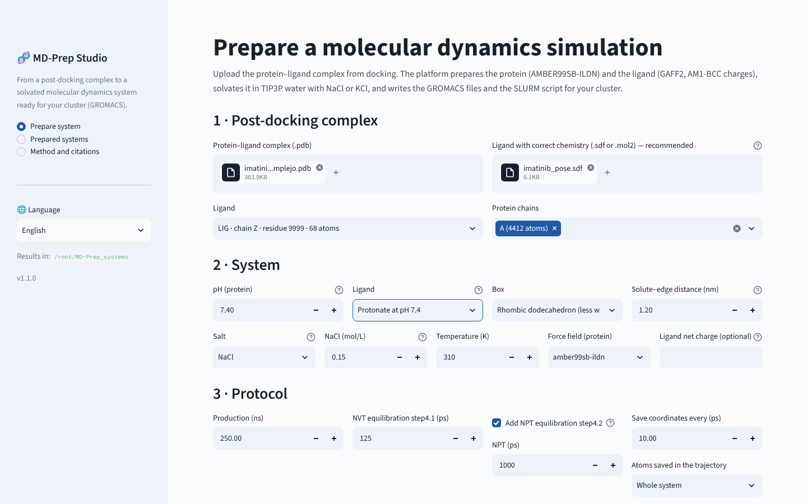
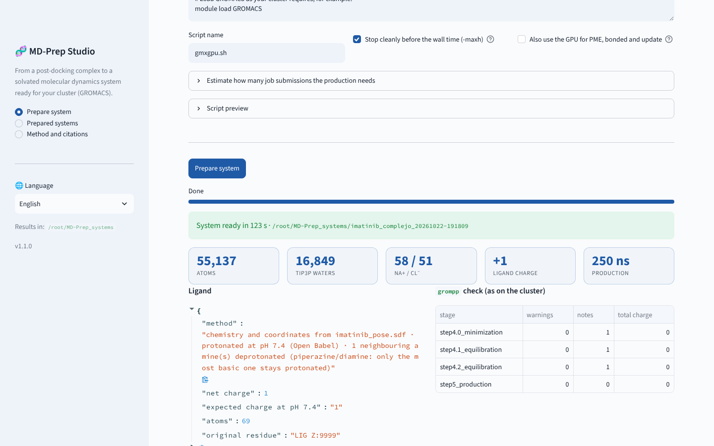

# MD-Prep Studio

**From a protein–ligand docking pose to a ready-to-run GROMACS molecular dynamics simulation, in a few clicks.**

MD-Prep Studio is a local web application (it runs on your computer and opens in the browser) that takes the complex
produced by molecular docking and builds a solvated, neutralized system for GROMACS. It also writes the SLURM script to run the simulation
on an HPC cluster. Every step uses established open-source tools and the force fields and settings most commonly used in the
literature. Each package also includes a **methods paragraph and the references** you need to cite in a paper.



## What it does

| Step | Tool |
|---|---|
| Missing heavy atoms, non-standard residues | PDBFixer |
| Protein protonation at a chosen pH (HID/HIE/HIP, ASH, GLH, LYN, CYX) | PDB2PQR + PROPKA |
| Protein topology | `gmx pdb2gmx` — AMBER99SB-ILDN, TIP3P |
| Ligand chemistry and protonation | RDKit + Open Babel (fixes double protonation of piperazines/diamines) |
| Ligand parameters | ACPYPE / antechamber — GAFF2, AM1-BCC charges |
| Box, water and ions | `gmx editconf`, `solvate`, `genion` — rhombic dodecahedron, 1.2 nm, 0.15 M NaCl or KCl |
| Index groups | default groups + `SOLU` (protein + ligand) and `SOLV` (water + ions), as in CHARMM-GUI |
| Check | `gmx grompp` of every stage before you upload anything |

You get a ZIP with:

```
step3_input.gro              solvated, neutralized system
topol.top + *.itp            topology (protein, ligand LIG, water, ions)
index.ndx                    index with SOLU / SOLV / LIG
step4.0_minimization.mdp     energy minimization
step4.1_equilibration.mdp    NVT equilibration (125 ps, position restraints)
step4.2_equilibration.mdp    NPT equilibration (1 ns, position restraints, optional)
step5_production.mdp         NPT production (250 ns by default)
gmxgpu.sh                    SLURM script: minimization → equilibration → production
continue.sh                  resumes the production run from the checkpoint if the job hits the wall time
METHODS_and_CITATIONS.md     methods paragraph with the real parameters of your system + references
references.bib               the same references in BibTeX (Zotero, Mendeley, LaTeX)
README_simulation.txt        summary of the system and how to run it
```

The interface and every generated file are available in **English and Spanish** (language selector in the sidebar).



## Installation

### Windows 10 / 11

1. Download `MD-Prep_Studio_<version>_Windows_EN.exe` from the [Releases](../../releases) page.
2. Run it. If Windows SmartScreen appears, click **More info → Run anyway** (the installer is not code-signed).
3. GROMACS and AmberTools are not available for Windows, so the installer sets up a small Linux system called **MD-Prep**
   inside WSL (the Windows Subsystem for Linux). If WSL is not enabled yet, Windows asks for administrator permission and one restart.
   The installer then continues on its own.
4. About 1.5 GB is downloaded; the installation takes 10–20 minutes.

Open the platform from the **MD-Prep Studio** desktop icon, or type `prepmd` in a terminal.

### macOS (Intel or Apple Silicon) and Linux

```bash
git clone https://github.com/Sbolivar16/MD-Prep-Studio.git
cd MD-Prep-Studio
sh install.sh        # uses your conda/Miniforge, or installs Miniforge if there is none
```

On macOS you can instead double-click `Install MD-Prep.command`. The first time, use right-click → Open.

Then open a **new** terminal and type `prepmd`. You can also run `sh start.sh`, or double-click `Open MD-Prep.command` on macOS.

### Manual installation (any system with conda)

```bash
conda env create -n md-prep -f environment.yml
conda activate md-prep
streamlit run app.py
```

## Usage

1. Upload the **PDB of the complex**, with the protein and the ligand in the docked pose. Also upload, recommended, the **SDF of the ligand**
   from the same pose, so bond orders and charge are exact. Without an SDF you can type a template SMILES. If you give neither,
   the chemistry is inferred by Open Babel.
2. Check the options. All of them have sensible defaults: pH 7.4, rhombic dodecahedron with 1.2 nm, 0.15 M NaCl, 310 K, 250 ns.
3. Enter your cluster settings: partition, cores, GPUs, wall time and the lines that load GROMACS.
4. Click **Prepare system** (2–10 min; ligand parametrization is the slowest step).
5. Download the ZIP and on the cluster:

```bash
scp system.zip user@cluster:~/
ssh user@cluster
unzip system.zip && cd <job_name>
sbatch gmxgpu.sh
sbatch continue.sh     # only if the production did not finish within the wall time (repeat until "Finished mdrun")
```

`.tpr` files are not included on purpose: `grompp` runs on the cluster because a `.tpr` written by a newer GROMACS cannot be read by
an older one. MD-Prep Studio still runs `grompp` locally to make sure every stage is valid.

## Configuration

`mdprep_config.json` sets the default language, the default SLURM settings of your cluster and, optionally, the results folder:

```json
{
  "lang": "en",
  "workdir": "",
  "slurm": {
    "partition": "gpu", "ntasks": 8, "gpus": 1, "time": "48:00:00", "nodes": 1,
    "modules": "module load GROMACS",
    "gpu_full": false, "maxh": true
  }
}
```

Results are saved in `~/MD-Prep_systems` (on Windows, inside the MD-Prep Linux system; the sidebar shows the path to open it from File Explorer).

## Method

**Protein.** The selected chains are kept; PDBFixer (Eastman et al., 2024) adds missing heavy atoms and replaces non-standard
residues (e.g. MSE → MET). Gaps of missing residues are not modelled: they are treated as chain ends. PDB2PQR
(Dolinsky et al., 2004; Jurrus et al., 2018) with PROPKA (Olsson et al., 2011) assigns the protonation state of every residue at the chosen pH
(HID/HIE/HIP, ASH, GLH, LYN, CYX) and `gmx pdb2gmx` builds the AMBER99SB-ILDN topology (Hornak et al., 2006; Lindorff-Larsen et al., 2010)
with TIP3P water (Jorgensen et al., 1983).

**Ligand.** The chemistry of the docking SDF/MOL2 (or the template SMILES) is used with the coordinates of the pose, handled with
RDKit and Open Babel (O'Boyle et al., 2011); hydrogens are added and ACPYPE (Sousa da Silva & Vranken, 2012) with antechamber from
AmberTools (Case et al., 2023) assigns GAFF2 parameters (Wang et al., 2004) and AM1-BCC charges (Jakalian et al., 2000; Jakalian et al., 2002).

**System.** Box (rhombic dodecahedron by default) with 1.2 nm between the solute and the box edge, TIP3P water, 0.15 M NaCl (or
KCl, for intracellular proteins) and the counter-ions needed for neutrality. The index file contains the `SOLU` (protein + ligand)
and `SOLV` (water + ions) groups, and the stages follow the CHARMM-GUI file naming (Lee et al., 2016).

**Protocol.**
| File | Stage | Details |
|---|---|---|
| `step4.0_minimization.mdp` | Minimization | steepest descent, Fmax < 1000 kJ mol⁻¹ nm⁻¹, position restraints |
| `step4.1_equilibration.mdp` | NVT | 125 ps, dt 1 fs, V-rescale (Bussi et al., 2007) at 310 K, position restraints |
| `step4.2_equilibration.mdp` | NPT (optional) | 1 ns, dt 2 fs, C-rescale (Bernetti & Bussi, 2020) at 1 bar, position restraints |
| `step5_production.mdp` | NPT production | 250 ns by default, dt 2 fs, V-rescale + C-rescale, unrestrained |

Common settings: Verlet scheme, PME (Darden et al., 1993; Essmann et al., 1995), 1.0 nm cut-offs, dispersion correction and H-bond
constraints with LINCS (Hess et al., 1997). Simulations run with GROMACS (Abraham et al., 2015); the equilibration protocol follows
the recommendations of Braun et al. (2018). The `.mdp` files only use options valid in GROMACS 2021 or newer.

**Why no `.tpr` files are shipped.** `grompp` is run on the cluster: `.tpr` files written by a newer GROMACS cannot be read by an
older one. The platform still runs `grompp` locally to check that everything is valid.

## Limitations

- Gaps of missing residues are not modelled; each gap is treated as a chain end (charged termini). Use a complete model
  (MODELLER, AlphaFold, CHARMM-GUI) if the gap is near the binding site.
- One small-molecule ligand per system; GAFF2 covers H, C, N, O, S, P, F, Cl, Br and I. Metal ions, cofactors, covalent ligands,
  glycans and membranes are not handled.
- Ligand protonation uses Open Babel rules plus a correction for neighbouring amines; check the net charge reported for unusual chemotypes.
- AM1-BCC charges are a fast, widely used approximation; for publication-critical work consider validating with RESP charges.

## How to cite

If MD-Prep Studio helps your research, please cite it (see `CITATION.cff` or the **Cite this repository** button on GitHub).
**Also cite the tools and methods it relies on.** The `METHODS_and_CITATIONS.md` file in every package lists them with your actual parameters.
They are:

**Simulation engine**
- Abraham, M. J., Murtola, T., Schulz, R., Páll, S., Smith, J. C., Hess, B., & Lindahl, E. (2015). GROMACS: High performance molecular simulations through multi-level parallelism from laptops to supercomputers. *SoftwareX*, *1–2*, 19–25. https://doi.org/10.1016/j.softx.2015.06.001

**Protein force field (AMBER99SB-ILDN)**
- Hornak, V., Abel, R., Okur, A., Strockbine, B., Roitberg, A., & Simmerling, C. (2006). Comparison of multiple Amber force fields and development of improved protein backbone parameters. *Proteins: Structure, Function, and Bioinformatics*, *65*(3), 712–725. https://doi.org/10.1002/prot.21123
- Lindorff-Larsen, K., Piana, S., Palmo, K., Maragakis, P., Klepeis, J. L., Dror, R. O., & Shaw, D. E. (2010). Improved side-chain torsion potentials for the Amber ff99SB protein force field. *Proteins: Structure, Function, and Bioinformatics*, *78*(8), 1950–1958. https://doi.org/10.1002/prot.22711

**Water model (TIP3P)**
- Jorgensen, W. L., Chandrasekhar, J., Madura, J. D., Impey, R. W., & Klein, M. L. (1983). Comparison of simple potential functions for simulating liquid water. *The Journal of Chemical Physics*, *79*(2), 926–935. https://doi.org/10.1063/1.445869

**Ligand force field (GAFF2)**
- Wang, J., Wolf, R. M., Caldwell, J. W., Kollman, P. A., & Case, D. A. (2004). Development and testing of a general amber force field. *Journal of Computational Chemistry*, *25*(9), 1157–1174. https://doi.org/10.1002/jcc.20035

**Ligand partial charges (AM1-BCC)**
- Jakalian, A., Bush, B. L., Jack, D. B., & Bayly, C. I. (2000). Fast, efficient generation of high-quality atomic charges. AM1-BCC model: I. Method. *Journal of Computational Chemistry*, *21*(2), 132–146. https://doi.org/10.1002/(SICI)1096-987X(20000130)21:2<132::AID-JCC5>3.0.CO;2-P
- Jakalian, A., Jack, D. B., & Bayly, C. I. (2002). Fast, efficient generation of high-quality atomic charges. AM1-BCC model: II. Parameterization and validation. *Journal of Computational Chemistry*, *23*(16), 1623–1641. https://doi.org/10.1002/jcc.10128

**AmberTools (antechamber, sqm)**
- Case, D. A., Aktulga, H. M., Belfon, K., Cerutti, D. S., Cisneros, G. A., Cruzeiro, V. W. D., et al. (2023). AmberTools. *Journal of Chemical Information and Modeling*, *63*(20), 6183–6191. https://doi.org/10.1021/acs.jcim.3c01153

**Ligand topology conversion to GROMACS**
- Sousa da Silva, A. W., & Vranken, W. F. (2012). ACPYPE - AnteChamber PYthon Parser interfacE. *BMC Research Notes*, *5*(1), 367. https://doi.org/10.1186/1756-0500-5-367

**Ligand chemistry perception and protonation**
- O'Boyle, N. M., Banck, M., James, C. A., Morley, C., Vandermeersch, T., & Hutchison, G. R. (2011). Open Babel: An open chemical toolbox. *Journal of Cheminformatics*, *3*, 33. https://doi.org/10.1186/1758-2946-3-33

**Ligand structure handling**
- RDKit contributors. RDKit: Open-source cheminformatics. https://www.rdkit.org. https://doi.org/10.5281/zenodo.591637

**Protein repair (PDBFixer, part of the OpenMM ecosystem)**
- Eastman, P., Galvelis, R., Peláez, R. P., Abreu, C. R. A., Farr, S. E., Gallicchio, E., et al. (2024). OpenMM 8: Molecular dynamics simulation with machine learning potentials. *The Journal of Physical Chemistry B*, *128*(1), 109–116. https://doi.org/10.1021/acs.jpcb.3c06662

**Protein protonation assignment**
- Dolinsky, T. J., Nielsen, J. E., McCammon, J. A., & Baker, N. A. (2004). PDB2PQR: An automated pipeline for the setup of Poisson–Boltzmann electrostatics calculations. *Nucleic Acids Research*, *32*(Web Server), W665–W667. https://doi.org/10.1093/nar/gkh381
- Jurrus, E., Engel, D., Star, K., Monson, K., Brandi, J., Felberg, L. E., et al. (2018). Improvements to the APBS biomolecular solvation software suite. *Protein Science*, *27*(1), 112–128. https://doi.org/10.1002/pro.3280

**pKa prediction**
- Olsson, M. H. M., Søndergaard, C. R., Rostkowski, M., & Jensen, J. H. (2011). PROPKA3: Consistent treatment of internal and surface residues in empirical pKa predictions. *Journal of Chemical Theory and Computation*, *7*(2), 525–537. https://doi.org/10.1021/ct100578z

**Long-range electrostatics (PME)**
- Darden, T., York, D., & Pedersen, L. (1993). Particle mesh Ewald: An N·log(N) method for Ewald sums in large systems. *The Journal of Chemical Physics*, *98*(12), 10089–10092. https://doi.org/10.1063/1.464397
- Essmann, U., Perera, L., Berkowitz, M. L., Darden, T., Lee, H., & Pedersen, L. G. (1995). A smooth particle mesh Ewald method. *The Journal of Chemical Physics*, *103*(19), 8577–8593. https://doi.org/10.1063/1.470117

**H-bond constraints (LINCS)**
- Hess, B., Bekker, H., Berendsen, H. J. C., & Fraaije, J. G. E. M. (1997). LINCS: A linear constraint solver for molecular simulations. *Journal of Computational Chemistry*, *18*(12), 1463–1472. https://doi.org/10.1002/(SICI)1096-987X(199709)18:12<1463::AID-JCC4>3.0.CO;2-H

**Thermostat (V-rescale)**
- Bussi, G., Donadio, D., & Parrinello, M. (2007). Canonical sampling through velocity rescaling. *The Journal of Chemical Physics*, *126*(1), 014101. https://doi.org/10.1063/1.2408420

**Barostat (C-rescale)**
- Bernetti, M., & Bussi, G. (2020). Pressure control using stochastic cell rescaling. *The Journal of Chemical Physics*, *153*(11), 114107. https://doi.org/10.1063/5.0020514

**Equilibration protocol and file naming**
- Lee, J., Cheng, X., Swails, J. M., Yeom, M. S., Eastman, P. K., Lemkul, J. A., et al. (2016). CHARMM-GUI Input Generator for NAMD, GROMACS, AMBER, OpenMM, and CHARMM/OpenMM simulations using the CHARMM36 additive force field. *Journal of Chemical Theory and Computation*, *12*(1), 405–413. https://doi.org/10.1021/acs.jctc.5b00935

**Best practices for setup and equilibration**
- Braun, E., Gilmer, J., Mayes, H. B., Mobley, D. L., Monroe, J. I., Prasad, S., & Zuckerman, D. M. (2018). Best practices for foundations in molecular simulations [Article v1.0]. *Living Journal of Computational Molecular Science*, *1*(1), 5957. https://doi.org/10.33011/livecoms.1.1.5957

All references are also in [`references.bib`](references.bib).

## License

MD-Prep Studio is released under the [MIT License](LICENSE). It does not redistribute GROMACS, AmberTools, ACPYPE, Open Babel,
RDKit, OpenMM/PDBFixer, PDB2PQR or PROPKA. They are installed from conda-forge and keep their own licenses.
